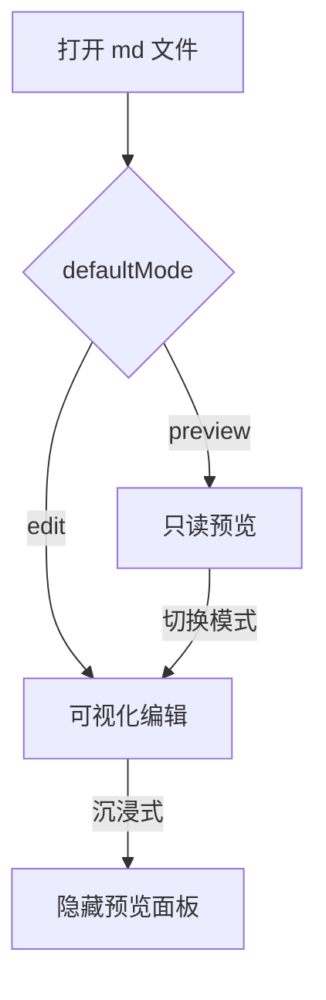

# Remons Markdown 编辑测试

这是一个用于测试 **可视化编辑器** 的示例文档。内容特意写得较长，以便复现滚动条、回到顶部按钮与目录（TOC）面板的定位问题。

## 功能演示

- [x] 工具栏编辑
- [x] 实时预览
- [ ] 图片上传

### 编辑能力细节

受控模式下 `value` 与 `onChange` 双向同步，CodeMirror 会把 CRLF 归一化为 LF，写回文档时再按原始换行符还原。下面是一段说明文字，用于撑高页面：

Markdown 可视化编辑器的核心难点在于「所见即所得」与「纯文本可控」之间的平衡。本示例通过工具栏命令直接操作 CodeMirror 事务，避免引入额外的富文本模型；预览侧则由 RenderMarkdown 独立完成渲染与增量更新，两侧只通过文档文本这一份权威快照通信。这样即使外部（文本编辑器、Git 切换分支）修改了文件内容，可视化视图也只会重新渲染而不会把编辑器回吐的 echo 变更误判为用户输入。

## 代码块

```ts
function greet(name: string) {
  return `Hello, ${name}!`;
}
```

### 更多语言高亮

```python
def fib(n: int) -> int:
    a, b = 0, 1
    for _ in range(n):
        a, b = b, a + b
    return a
```

```sql
SELECT u.name, COUNT(p.id) AS post_count
FROM users u
JOIN posts p ON p.author_id = u.id
WHERE u.created_at >= '2026-01-01'
GROUP BY u.name
HAVING COUNT(p.id) > 5
ORDER BY post_count DESC;
```

## 表格

| 能力 | 说明 |
| --- | --- |
| 受控编辑 | value + onChange |
| 自定义容器 | useRegisterToolbar |

### 长表格（横向滚动测试）

| 模块 | 职责 | 依赖 | 状态 | 备注 |
| --- | --- | --- | --- | --- |
| webview | React 界面与消息桥接 | remons-markdown-editor | 稳定 | 主题、沉浸式状态持久化 |
| extension | 自定义编辑器提供者 | vscode API | 稳定 | WorkspaceEdit 写回文档 |
| render-markdown | Markdown 渲染 | markdown-it, hljs | 迭代中 | TOC / BackTop / Mermaid |
| markdown-editor | 可视化编辑面板 | CodeMirror 6 | 迭代中 | 工具栏与滚动同步 |
| plugins | 扩展容器组件 | remons-markdown-plugins | 实验 | 需本地 link 联调 |

## 列表与嵌套

1. 第一项
   - 嵌套条目 A
   - 嵌套条目 B
     1. 更深层的有序列表
     2. 用于验证缩进渲染
2. 第二项
3. 第三项

- 无序列表很长的时候会出现折行，这里补充一段占位文字让条目占据更多高度：滚动容器、滚动条位置、回到顶部按钮、目录面板这几者之间的定位关系是本次调试的重点。
- 第二个条目
- 第三个条目

## 引用与分隔

> 试着在这里编辑内容，切换回普通文本编辑器可看到内容已同步。

> [!NOTE]
> GitHub 风格 Alert，用于验证插件渲染分支。

---

## Mermaid 图表



## 标题锚点验证

### 三级标题 A

这一段没有实际意义，只用来增加高度，方便把页面撑出滚动条。滚动后请观察：滚动条是否贴在视口最右侧，而不是出现在窗口中间靠右的位置。

### 三级标题 B

正文列宽被限制为 960px 并水平居中，因此当面板宽度大于 960px 时，正文两侧会留下空白。如果滚动容器是被限宽的那个元素，滚动条就会落在限宽列的右边缘上，看起来像"中间靠右"。

#### 四级标题 B-1

再补一段占位文字。TOC 按钮与目录面板在组件库中使用绝对定位，若它们相对的是滚动容器，滚动时会随正文一起离开视口；改为固定定位后需要重新计算横向位置，使其仍贴在正文列右侧。

#### 四级标题 B-2

占位段落：主题切换（深/浅）、沉浸式编辑、全屏这三条状态轴两两组合时，滚动容器的选取都会变化，因此回到顶部按钮的监听容器需要在模式切换后重新绑定。

## 图片与链接

- [RenderMarkdown 仓库](https://github.com/liRemons/render-markdown)
- [VSCode 扩展 API 文档](https://code.visualstudio.com/api/extension-guides/webview)

## 结尾

> 滚动到此处说明文档高度已足够，可用于验证「回到顶部」按钮的显示阈值与点击行为。
